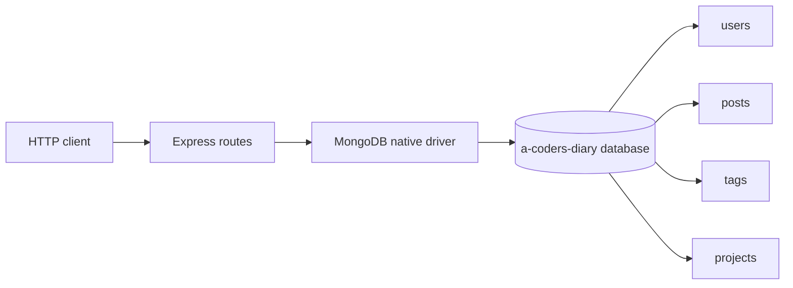

# A Coders Diary Server

> A legacy Express and MongoDB API prototype for the A Coders Diary blogging project.

[](https://github.com/montasim/a-coders-diary-server)
[](package.json)
[](https://www.supportkori.com/montasim)

This repository contains the original server prototype behind A Coders Diary, a learning project where developers could record posts, tags, projects, and profiles. It is useful as a compact example of an Express application connected directly to MongoDB, but it is **not ready for public or production deployment** in its current form.

**[Inspect the API source](index.js) · [View the client repository](https://github.com/montasim/a-coders-diary) · [Report a problem](https://github.com/montasim/a-coders-diary-server/issues)**

> [!WARNING]
> The current API has no authentication or authorization middleware. Several public routes create, promote, or delete records. Run it only against disposable development data on a trusted local network until access control and validation are implemented.

## What it contains

- Express routes for users, administrators, posts, tags, and projects
- MongoDB collections accessed through the native MongoDB driver
- JSON request parsing and permissive CORS
- Environment-based database credentials and port selection
- Development and production start scripts

## Current API surface

The implementation in [`index.js`](index.js) registers these routes:

| Method | Route | Current behavior |
| --- | --- | --- |
| `GET` | `/` | Returns a basic server response |
| `GET` | `/users` | Returns records whose `userRole` is `user` |
| `POST` | `/create-user` | Inserts the request body into `users` |
| `DELETE` | `/delete-user/:_id` | Deletes a user by MongoDB ObjectId |
| `GET` | `/admins` | Returns users whose role is `admin` |
| `PUT` | `/create-admin/:userEmail` | Changes a user role to `admin` |
| `PUT` | `/remove-admin/:userEmail` | Changes a user role to `user` |
| `GET` | `/author-details/:_id` | Returns one user |
| `GET` | `/posts` | Returns all posts |
| `GET` | `/post-details/:_id` | Returns one post |
| `GET` | `/my-posts?postAuthor=...` | Returns posts for an author |
| `GET` | `/edit-post/:_id` | Returns the post selected for editing |
| `POST` | `/create-post` | Inserts the request body into `posts` |
| `DELETE` | `/delete-post/:_id` | Deletes one post |
| `GET` | `/tags` | Returns all tags |
| `POST` | `/add-tag` | Inserts the request body into `tags` |
| `GET` | `/edit-tag/:_id` | Returns one tag |
| `DELETE` | `/delete-tag/:_id` | Deletes one tag |
| `GET` | `/projects` | Returns all projects |
| `GET` | `/project-details/:_id` | Returns one project |

There is a second `GET /users` handler intended to query by `userEmail`, but Express reaches the earlier handler first. Do not rely on email lookup without correcting the route design.

## How it works



The server creates a MongoDB Atlas connection string from `DB_USER` and `DB_PASSWORD`, connects once during startup, and registers route handlers over four collections. There is no schema layer, request validation, authentication, or centralized error response.

## Local development

### Prerequisites

- A maintained Node.js release compatible with the locked dependencies
- npm
- A disposable MongoDB Atlas database

The repository does not declare an exact Node.js engine. Prefer a current Node.js LTS release and verify the legacy dependency set before upgrading it.

### 1. Clone and install

```bash
git clone https://github.com/montasim/a-coders-diary-server.git
cd a-coders-diary-server
npm ci
```

### 2. Configure the environment

Create a local `.env` file:

```dotenv
DB_USER=your_atlas_database_user
DB_PASSWORD=your_atlas_database_password
PORT=5000
```

The username and password are interpolated into a hard-coded Atlas cluster URL in `index.js`. That cluster hostname is project-specific; using another MongoDB deployment requires changing the URI construction in the source.

Never commit `.env` or real database credentials. Use a database user restricted to disposable development data because the API exposes unauthenticated write and delete routes.

### 3. Start the server

```bash
npm start
```

The default local address is [http://localhost:5000](http://localhost:5000).

For automatic restarts during development:

```bash
npm run start-dev
```

### 4. Make a safe read request

```bash
curl http://localhost:5000/posts
```

Do not exercise mutation routes against data you cannot restore.

## Available commands

| Command | Purpose |
| --- | --- |
| `npm start` | Run `index.js` with Node.js |
| `npm run start-dev` | Run the server with nodemon |
| `npm test` | Placeholder that exits with failure; no test suite is configured |

## Project status and limitations

This is a legacy learning project, not a maintained production service.

- No authentication or authorization protects administrative or destructive operations.
- Request bodies are inserted without schema validation or field allowlists.
- CORS is unrestricted.
- Invalid ObjectIds and database errors do not have centralized handling.
- Two handlers share `GET /users`; the later email-query handler is effectively shadowed.
- The MongoDB Atlas hostname and database name are hard-coded.
- There are no tests, CI workflow, API schema, migrations, seed scripts, or deployment configuration.
- The previous README referenced Heroku hosting, but this repository does not contain enough current evidence to claim that deployment is still available.

These limitations should be addressed before connecting a public client or real user data.

## Related project

The historical front-end repository is [montasim/a-coders-diary](https://github.com/montasim/a-coders-diary). Its availability and configuration are maintained independently.

## Support and security

Use [GitHub Issues](https://github.com/montasim/a-coders-diary-server/issues) for reproducible local-development problems. Include the Node.js version, route, sanitized request, expected response, and actual response. Never include database credentials, connection strings, access tokens, or personal records.

This repository does not include a dedicated security policy. Report sensitive concerns privately to [Montasim](mailto:montasimmamun@gmail.com), not in a public issue.

## Contributing

Security and correctness work should come before new features. High-value improvements include authentication, authorization, route validation, safe error handling, a configurable MongoDB URI, tests, and a documented API contract.

The repository does not currently include dedicated contribution or code-of-conduct files. Open an issue before a substantial change, keep pull requests focused, and document any behavior or configuration changes.

## Funding

Optional support for maintained public work is available through [SupportKori](https://www.supportkori.com/montasim). For this legacy project, tested security fixes and documentation improvements are more valuable than feature expansion.

## Author

Built by [Montasim](https://github.com/montasim).

## License

`package.json` declares `ISC`, but this repository does not contain a license file. Until the maintainer adds explicit license text, do not assume permission to copy, modify, or redistribute the code.
